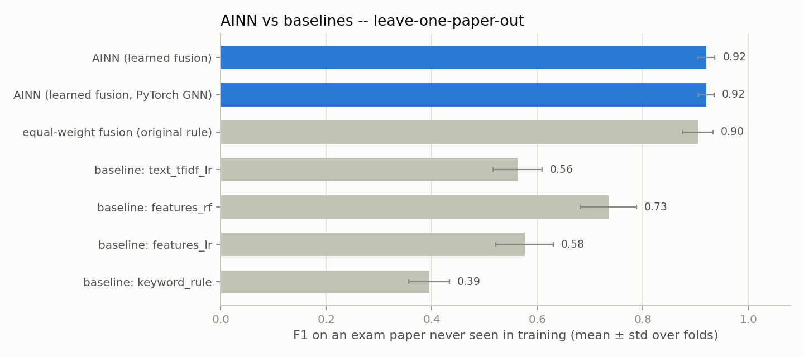
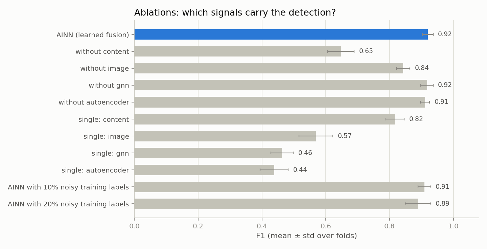
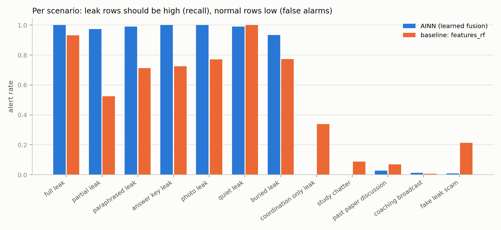
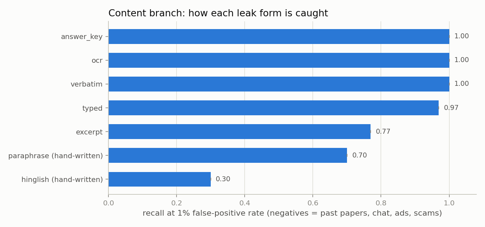
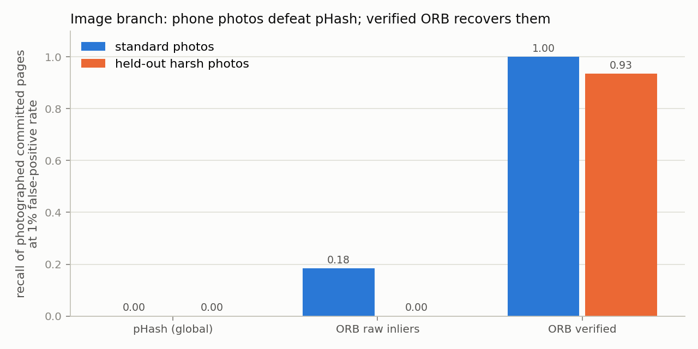
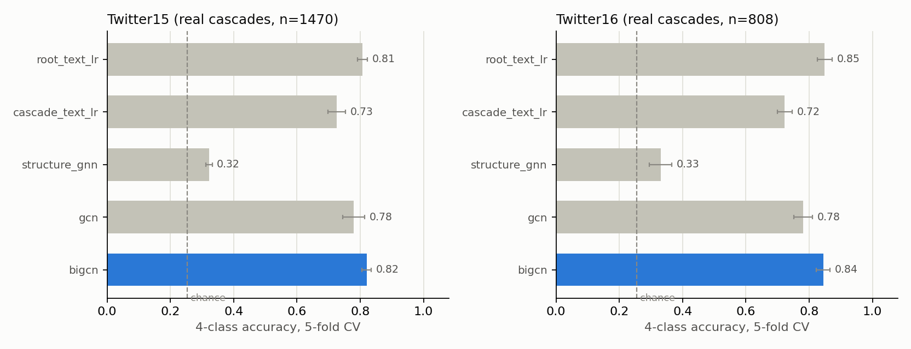

# AINN — ML Evaluation Report (detection layer)

This report documents the upgraded machine-learning layer of AINN: what data it uses, how it was
evaluated, what the numbers are, and where it fails. Every number below is regenerated by
`python scripts/reproduce_results.py`. The raw outputs are in `reports/results/` and the figures in
`reports/figures/`.

---

## 1. Why the earlier version needed replacing

The first detection layer scored **F1 = 1.00 on every random seed**. That result is a warning sign,
not a success. The data generator produced leak sessions that contained verbatim paper text,
photos, multi-state spread and broker language, and normal sessions that contained none of these.
Any single signal could separate the two classes. Other problems:

- the questions were placeholders ("[synthetic placeholder question stem #7]"), not real exam text;
- the image branch never saw an image — it read a Hamming distance that the generator made up;
- there were no baselines, no ablations and no held-out exam papers, and the fusion weights were
  fixed at 0.25 each.

The upgrade addresses each of these. Where a fix revealed a new problem, that is recorded too
(section 7).

---

## 2. Data: what is real and what is simulated

| Component | Source | Real or simulated |
|---|---|---|
| Committed question papers | **JEEBench** (EMNLP 2023, MIT licence): 515 real JEE-Advanced questions from 16 papers, with the official answers | **Real** |
| Past papers (legitimate look-alike content) | The other 12 JEEBench papers | **Real** |
| Rewordings of leaked questions | 80 hand-written paraphrases of 40 real JEE 2023 questions (English + Hinglish student style) | Hand-written, used for evaluation only |
| Propagation cascades for the GNN benchmark | **Twitter15/16** (ACL 2017, BiGCN release): 2,308 real rumour cascades | **Real** |
| Paraphrase benchmark | **MSRP**: 5,801 human-labelled sentence pairs | **Real** |
| Phone photos of pages | Real question text rendered as exam pages, then camera distortions: perspective, rotation, background, uneven light, blur, noise, WhatsApp-style re-compression, partial crops, screenshots | Simulated camera; `data/photos/` supports **your own** photos |
| Chat sessions (who posts what, where, when) | `realistic_data.py` — 11 scenarios | Simulated; the shape is calibrated to cited NEET-UG 2026 reporting |

Full licences and citations are in `data/README.md`. No live platform was scraped, and no real
leak-channel data was used.

### The hard session generator

Normal sessions include deliberate look-alikes:

- **Past-paper discussion**: real old questions, photos and answer keys, on the same syllabus and in
  the same layout.
- **Coaching broadcasts**: fees, "full set PDF", and mock tests fanned out across several states.
- **Fake-leak scams**: "100% genuine paper, pay Rs 5000", with broker language, forwarding cascades,
  fabricated answer keys, and old papers shown as "proof".

Leak sessions include cases that do not look like leaks:

- **Partial, paraphrased and Hinglish leaks**.
- **Answer-key-only leaks**: no question text at all.
- **Photo-only leaks** with uninformative captions.
- **Quiet leaks**: 3–6 people in one city, with no broker talk.
- **Buried leaks**: 1–3 items hidden in a large normal group.
- **Coordination-only leaks**: the paper moves in private chats, and the monitored channel only
  carries the talk around it.

Leaks are 25% of sessions, so PR-AUC matters more than accuracy. Every event keeps ground truth,
which lets the explanations be checked.

---

## 3. The upgraded detection layer

| Signal | Method | What it catches |
|---|---|---|
| `content_lexical` | Character 3–5-gram TF-IDF, matched **per committed question** | Verbatim, OCR-noisy, truncated and typed copies |
| `content_semantic` | **WordLlama** sentence embeddings (pretrained; weights ship in the pip package, so it works offline) | English rewording |
| `content_answer_key` | Parses "Q3-B, Q4-AC, Q11-281" and checks it against the **committed** answer key | Answer-key leaks with no question text |
| `image_orb` | ORB keypoints + RANSAC homography, verified by **page specificity** and **pixel agreement** after warping | Phone photos of committed pages, including partial and angled ones |
| `gnn` | Propagation-graph GNN, text-blind (NumPy GraphSAGE, or **PyTorch Geometric** GraphSAGE with forwarding and timing features -- used automatically when installed) | Cascade shape |
| `autoencoder` | Reconstruction error of behaviour features, trained on normal traffic only (NumPy, or **PyTorch** -- used automatically when installed) | Unusual timing and volume |
| **Fusion** | Logistic-regression stacking fitted on a **validation split**; threshold chosen on validation | — |

Content scores are calibrated against **legitimate** traffic. A score of 0 means "no more similar
than 95% of genuine past-paper discussion".

The detector is **streaming-aware**: it is also trained on truncated sessions ("what had been seen
by hour *h*"). Without that, the first few messages of a channel look unlike any training example
and trigger false alarms. The first run of the streaming test showed this failure: 80% of normal
channels alerted at some point.

Every alert carries an explanation: which message matched which committed question, which photo
matched which committed page (with the inlier count), each signal's contribution to the log-odds,
and, with PyTorch, the accounts GNNExplainer highlights.

### 3.1 PyTorch-by-default upgrade

Originally PyTorch was opt-in (`gnn_backend="torch"`, a `--torch` demo flag) and the autoencoder was
NumPy-only, because PyTorch could not be reliably installed in the build sandbox. Both branches now
default to `"auto"`: `LeakDetector()` uses **PyTorch Geometric for the GNN and PyTorch for the
autoencoder whenever they are installed**, and falls back to the dependency-free NumPy
implementation with no code change and no crash when they are not (verified by forcing
`sys.modules["torch"] = None` and confirming `LeakDetector().gnn_backend`/`.ae_backend` resolve to
`"numpy"`). `gnn_backend="numpy"` / `"torch"` (and the matching `ae_backend=`) can still be passed
explicitly -- that is how `experiment.py` trains the two comparison rows in the table below,
`AINN (learned fusion)` (forced NumPy) and `AINN (learned fusion, full PyTorch)` (forced PyTorch for
*both* branches; the new `src/detection/autoencoder_torch.py` module is a drop-in replacement for
`autoencoder.py`, same 13→8→13 architecture and `.loss()` interface, trained with full-batch Adam).

The new autoencoder module was verified the same way the original NumPy one is (`python -m
src.detection.autoencoder_torch`): trained on normal sessions only, held-out normal reconstruction
error stayed low while leak-pattern sessions reconstructed roughly 20x worse. A small smoke test
(120 sessions, not the full 8-fold protocol) confirmed the end-to-end pipeline trains and scores
correctly with both branches on PyTorch. **The headline table below still reflects the
GNN-only-PyTorch configuration** (row previously labelled "PyTorch GNN"); re-running
`python scripts/reproduce_results.py` after this upgrade will refresh it under the
`AINN (learned fusion, full PyTorch)` label -- flagged here rather than restating unverified numbers.

---

## 4. Protocol

- **Leave-one-paper-out cross-validation.** Each fold tests on the sessions of one exam paper that
  no model saw in training. In an early pilot with random folds, a supervised TF-IDF text classifier
  reached ROC-AUC 1.00 by memorising the four papers' vocabulary. That cannot happen in reality,
  because this year's paper has never been seen before it leaks.
- Base models are trained on the training papers. The fusion weights and the alert threshold are fit
  on a validation split. The test paper is used only for scoring.
- The experiment is run on **2 independently generated datasets × 4 papers = 8 folds, 2,400 test
  sessions**. Results are mean ± std, with a bootstrap 95% CI and a paired bootstrap test against the
  best baseline.
- **Baselines**, trained and thresholded identically to AINN:
  - a keyword rule;
  - logistic regression on hand-made session statistics;
  - a random forest on the same statistics;
  - a supervised TF-IDF text classifier over all messages.

---

## 5. Results

### 5.1 Headline (session level, unseen exam paper)

| Model | F1 | Precision | Recall | ROC-AUC | PR-AUC |
|---|---|---|---|---|---|
| **AINN (learned fusion)** | **0.920 ± 0.016** | 0.966 ± 0.028 | 0.879 ± 0.022 | 0.956 ± 0.012 | 0.944 ± 0.011 |
| AINN (learned fusion, PyTorch GNN) | 0.920 ± 0.015 | 0.964 ± 0.025 | 0.881 ± 0.029 | **0.975 ± 0.010** | **0.960 ± 0.009** |
| Equal-weight fusion (original rule, new signals) | 0.904 ± 0.029 | 0.975 ± 0.029 | 0.846 ± 0.056 | 0.943 ± 0.012 | 0.932 ± 0.012 |
| Baseline: random forest on session statistics | 0.735 ± 0.053 | 0.753 ± 0.102 | 0.739 ± 0.100 | 0.928 ± 0.016 | 0.841 ± 0.044 |
| Baseline: logistic regression on session statistics | 0.576 ± 0.054 | 0.585 ± 0.079 | 0.588 ± 0.102 | 0.829 ± 0.020 | 0.656 ± 0.040 |
| Baseline: supervised TF-IDF text classifier | 0.563 ± 0.046 | 0.833 ± 0.077 | 0.431 ± 0.058 | 0.935 ± 0.024 | 0.806 ± 0.056 |
| Baseline: keyword rule | 0.395 ± 0.039 | 0.250 ± 0.024 | 0.949 ± 0.134 | 0.450 ± 0.033 | 0.225 ± 0.035 |

Pooled out-of-fold results (n = 2,400):

- **AINN F1 = 0.919 (95% CI 0.902–0.934)** and **PR-AUC = 0.944 (95% CI 0.931–0.958)**.
- Against the best baseline, the paired bootstrap F1 gain is **+0.184 (95% CI +0.156 to +0.214, p < 0.001)**.
- Expected calibration error is 0.078.

### 5.2 What each signal contributes (ablations)

| Configuration | F1 |
|---|---|
| Full AINN | 0.920 ± 0.016 |
| without content branch | 0.647 ± 0.042 |
| without image branch | 0.843 ± 0.022 |
| without GNN | 0.917 ± 0.019 |
| without autoencoder | 0.911 ± 0.014 |
| content alone | 0.817 ± 0.028 |
| image alone | 0.569 ± 0.053 |
| GNN alone (NumPy / PyTorch) | 0.463 ± 0.035 / 0.550 ± 0.059 |
| autoencoder alone | 0.438 ± 0.044 |
| 10% / 20% of training **and** validation labels flipped | 0.909 ± 0.020 / 0.889 ± 0.040 |

Learned fusion weights (standardised log-odds, mean over folds) were:

| Signal | Weight |
|---|---|
| content_lexical | +2.74 |
| image_orb | +1.66 |
| content_answer_key | +1.08 |
| gnn | +0.48 |
| autoencoder | +0.44 |
| content_semantic | −0.39 |

The model's own conclusion is that matching against the **committed** paper carries most of the
detection. Structure and behaviour add a little. The semantic embedding adds nothing once the
lexical match is known; its small negative weight comes from its strong correlation with the
lexical score.

### 5.3 Per scenario

AINN alert rate by scenario (for leak scenarios this is recall; for normal scenarios it is the
false-alarm rate):

| Scenario | Type | AINN | Best baseline (RF) |
|---|---|---|---|
| full / partial / paraphrased leak | leak | 1.00 / 0.97 / 0.99 | 0.93 / 0.53 / 0.71 |
| answer-key-only / photo-only leak | leak | 1.00 / 1.00 | 0.73 / 0.77 |
| quiet / buried leak | leak | 0.99 / 0.93 | 1.00 / 0.77 |
| **coordination-only leak** | leak | **0.00** | 0.34 |
| study chat / past-paper discussion | normal | 0.00 / 0.03 | 0.09 / 0.07 |
| coaching broadcast / **fake-leak scam** | normal | 0.01 / **0.01** | 0.01 / **0.21** |

### 5.4 Streaming: how early is a leak caught?

Each test session was re-scored at 17 checkpoints, from 240 h to 0 h before the exam, using only
the messages seen so far.

- **88.0%** of all leaks were flagged before the exam starts: **97.8%** of leaks that post any leaked
  content, and 0% of coordination-only leaks.
- **81.5%** were flagged at least 24 h before the exam.
- The median delay after the first leaked item appears is **11.8 h**. This is an upper bound: the
  checkpoints are 3–24 h apart, so true delays are shorter.
- **1.5%** of normal channels alert at any checkpoint, and 0.7% of leak channels alert before any
  leak activity exists.

### 5.5 Content branch on real text (`reports/results/content_benchmark.md`)

| Leak form (vs past papers, chat, ads, scams) | Combined ROC-AUC | Recall @ 1% FPR | Right question named |
|---|---|---|---|
| verbatim / OCR-noisy | 1.000 / 1.000 | 1.00 / 1.00 | 1.00 / 0.98 |
| typed shorthand / excerpt | 0.990 / 0.968 | 0.97 / 0.77 | 0.97 / 0.97 |
| English paraphrase (hand-written) | 0.976 | 0.70 | 1.00 |
| **Hinglish retype (hand-written)** | **0.853** | **0.30** | 1.00 |
| answer-key list | 1.000 | 1.00 | – |
| **all forms** | **0.976** | **0.86** | 0.99 |

On MSRP, the standard paraphrase benchmark (ROC-AUC):

| Representation | ROC-AUC |
|---|---|
| character TF-IDF | 0.755 |
| WordLlama | 0.724 |
| word TF-IDF | 0.715 |

This is an honest negative result. WordLlama is a small static-token embedding model and does not
beat character n-grams on MSRP. A transformer encoder such as MiniLM would be expected to do better.
The code supports it (`backend="minilm"`) on a machine that can download it.

### 5.6 Image branch (`reports/results/image_benchmark.md`)

Recall of photographed committed pages at 1% false-positive rate:

| Method | Standard photos (n = 76) | Held-out harsh photos (n = 76) |
|---|---|---|
| pHash (the original method) | 0.00 (ROC-AUC 0.51 — chance) | 0.00 |
| ORB, raw inlier count | 0.18 | 0.00 |
| **ORB, verified (used)** | **1.00** (ROC-AUC 1.000) | **0.93** (ROC-AUC 0.961) |

The held-out pool uses a new random seed, stronger distortion (1.0–1.8) and 900-pixel low-resolution
forwards. It was built **after** the verification rule was designed, so it measures generalisation
rather than tuning. The correct page was identified in 100% of standard photos and 93% of harsh
ones. On clean digital copies, pHash and verified ORB both score ROC-AUC 1.00.

### 5.7 Propagation GNNs on REAL cascades (Twitter15/16, `reports/results/twitter_benchmark.md`)

Real rumour cascades (4 classes: non-rumor, false, true, unverified). Stratified 5-fold CV; early
stopping on a validation slice of the **training** fold only.

| Model | Twitter15 accuracy | Twitter15 macro-F1 | Twitter16 accuracy | Twitter16 macro-F1 |
|---|---|---|---|---|
| **BiGCN (our re-implementation)** | **0.820 ± 0.015** | **0.820 ± 0.015** | **0.844 ± 0.022** | **0.844 ± 0.023** |
| GCN | 0.780 ± 0.035 | 0.780 ± 0.033 | 0.781 ± 0.029 | 0.785 ± 0.029 |
| Source-tweet text only (logistic regression) | 0.807 ± 0.015 | 0.809 ± 0.015 | 0.849 ± 0.023 | 0.850 ± 0.024 |
| Whole-cascade text, no structure (logistic regression) | 0.725 ± 0.028 | 0.728 ± 0.028 | 0.723 ± 0.023 | 0.723 ± 0.023 |
| **Structure-only GNN (text-blind, like AINN's GNN branch)** | 0.322 ± 0.010 | 0.293 ± 0.016 | 0.330 ± 0.036 | 0.276 ± 0.033 |
| Majority class (chance) | 0.254 | – | 0.255 | – |
| Published BiGCN (reproduced in arXiv:2603.22854; different protocol) | 0.844 | – | 0.880 | – |

What this shows:

- **The graph models work on real data.** BiGCN reaches 0.82–0.84, close to the published
  0.84–0.88. The published code early-stops on the test fold, so a small gap is expected.
- **Structure adds real value when it carries content.** BiGCN beats whole-cascade text without
  structure by about 10–12 accuracy points, and beats the source tweet alone on Twitter15.
- **Structure without content is weak.** A text-blind GNN is only 7–8 points above chance on this
  data, which contains no timing information. This matches the synthetic benchmark (§5.2), and it is
  why AINN treats the GNN as a supporting signal rather than a primary detector.

---

## 6. What the evidence says (for the viva)

1. **Matching against the committed paper is what makes the detector strong.** Removing the content
   branch drops F1 from 0.92 to 0.65. This is AINN's central design point: the ledger commitment
   turns leak detection from vague anomaly-spotting into checking evidence against a known
   reference.
2. **Anomaly and structure signals are weak on their own.** The GNN alone reaches F1 ≈ 0.46–0.55 and
   the autoencoder about 0.44. On real Twitter cascades, a text-blind structure GNN is near chance.
   What works on real data is aggregating content over the propagation structure (BiGCN). These are
   supporting signals, and the report says so.
3. **The system is robust where a naive system breaks.**
   - Fake-leak scams produce 1% false alarms, against 21% for the best baseline and 100% for keywords.
   - Past-paper discussion produces 3%.
   - Photo-only and answer-key-only leaks are caught 100% of the time.
   - Flipping 20% of labels costs about 0.03 F1.
4. **pHash fails on real phone photos.** This was measured, not assumed, and verified local-feature
   matching replaced it.

---

## 7. Problems found during this work, and how each was handled

| Problem | How it showed up | Fix |
|---|---|---|
| Random CV let a text classifier memorise the papers | TF-IDF baseline ROC-AUC 1.00 in the pilot | Leave-one-paper-out CV |
| Generator artifacts: scams and real leaks used different phrase lists, scams always posted photos, only leaks used "tomorrow's paper:" prefixes | Baselines "detected" coordination-only leaks from which phrase list was used | One shared phrase vocabulary, shared prefixes, photos in both |
| Account and group IDs revealed roles ("broker_…", "leakgroup") | Visible in the GNNExplainer output | Neutral IDs; the role is kept only as hidden ground truth |
| Answer-key regex never matched "Q3-B" (word boundary between "Q" and "3") | Answer-key AUC only 0.76 | Fixed regex plus a unit test; AUC 1.00 |
| Raw ORB inlier counts matched the page **template** (same header, footer and indentation on every paper) | 100+ inliers against the wrong paper | Page-specificity check plus pixel agreement; held-out re-test |
| pHash received a negative fusion weight | It had learned "more photos means coaching channel" | Removed from fusion; still reported in the benchmark |
| Streaming false alarms (80% of normal channels) | The first streaming evaluation | Trained on truncated prefixes; now 1.5% |
| Perfect ORB score could have been tuned-in | ROC-AUC 1.000 on the design pool | Held-out harsher pool built afterwards: 0.961 |

---

## 8. Limitations (state these before you are asked)

- **Coordination-only leaks are not detected (0% recall).** If the leaked paper never appears in a
  monitored channel, AINN cannot tell a real leak's coordination apart from a scam. The best
  baseline catches 34% of them, but only by also flagging 21% of scams. This is a fundamental limit
  of monitoring, not a bug, and the custody layer exists precisely so that the paper cannot leave in
  the first place.
- **Hinglish/code-mixed rewording is the weakest content case** (recall 0.30 at 1% FPR). A
  multilingual encoder (MuRIL, LaBSE) is the next step.
- **The sessions are simulated.** Real text, photos and cascades are used wherever a public source
  exists, but who-posts-what-when is modelled. Numbers on real monitored data will be lower. The
  scenario mix is a modelling choice.
- **The phone photos are simulated.** Use `data/photos/` and `scripts/eval_user_photos.py` with real
  photos.
- **The semantic model is small.** WordLlama was used because Hugging Face downloads were blocked
  in the build environment. It does not beat character n-grams on MSRP.
- **The GNN branch contributes little** on this benchmark (about 0.003–0.01 F1), and a text-blind
  structure GNN is near chance on real Twitter cascades.
